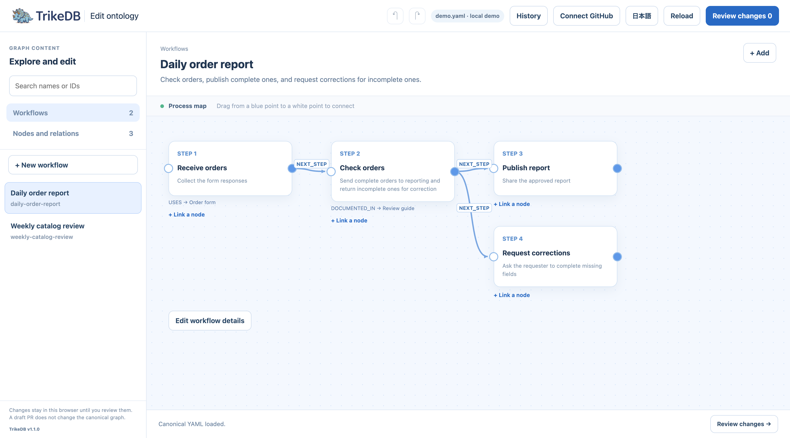

# Ontology editor example

This is a small, fictional graph editor for TrikeDB. It demonstrates workflow steps, reusable ontology nodes, relationships, YAML diff review, and optional draft pull requests through a GitHub App. It does not contain a company graph or credentials.



## Run locally

From the repository root:

```sh
docker compose -f examples/review_app/compose.yaml up --build -d
```

Open <http://127.0.0.1:8765/>. The included `demo.yaml` is read only inside the container. Browser changes remain local until submitted; the local demo can preview a YAML diff but cannot publish a PR.

Use **Undo** and **Redo** in the top bar, or `⌘Z` / `⇧⌘Z` on macOS and `Ctrl+Z` / `Ctrl+Y` on Windows and Linux. Text fields keep their normal typing history. Relationship labels stay in front of the connection lines and can be clicked to remove a relationship from the draft.

Click a workflow step to edit it in a wide dialog that stays within the viewport. Its related ontology nodes appear beside the step fields, with a link action in the same dialog. The node map shows only direct relationships of the selected node; use the sidebar search or the relationship form to find any other node. When connected to GitHub, **History** shows recent commits to the selected canonical YAML file. The local demo has no canonical commit history.

Stop it with:

```sh
docker compose -f examples/review_app/compose.yaml down
```

To use your own graph, mount a reviewed YAML file read only and set `GRAPH_FILE` to its path inside the container. The sample graph is deliberately fictional. TrikeDB validates proposed YAML before a PR is created.

## Optional GitHub App publishing

For the in-app setup wizard, deploy behind HTTPS and set `PUBLIC_BASE_URL` to its public base URL and `SETUP_TOKEN` to a random secret of at least 24 characters. The supplied Compose file binds only to local loopback so you can place a TLS reverse proxy in front. Open **Connect GitHub**, enter the setup token and an existing repository/YAML path, register the preconfigured App on GitHub, install it **only on the selected repository**, then press **Check connection**. The wizard uses GitHub's [App manifest flow](https://docs.github.com/en/apps/sharing-github-apps/registering-a-github-app-from-a-manifest); it requests only `Contents: Read and write` and `Pull requests: Read and write`, with webhooks disabled. The generated private key is saved with mode 0600 in the named `/state` volume. The setup token doubles as the editor token unless `EDITOR_TOKEN` is set separately.

Alternatively, register your own GitHub App and set these environment variables at runtime: `GITHUB_REPOSITORY` (`owner/repo`), `GITHUB_GRAPH_PATH` (path to a YAML graph on `main`), `GITHUB_APP_ID`, `GITHUB_INSTALLATION_ID`, `GITHUB_APP_PRIVATE_KEY_FILE`, and `EDITOR_TOKEN`. Mount the private key file read only at the configured path; never put the key in an image, source file, or build argument. Install the App only on the selected repository, with repository `Contents: Read and write` and `Pull requests: Read and write` permissions. The server fetches the current `main` file, rejects stale edits, and creates a **draft** PR after the user previews the exact YAML diff. Review and merge remain in GitHub.

The editor token in this example is one shared secret. For a multiuser deployment, put authenticated access control and TLS in front of the service, issue user specific authorization, and record the authenticated identity in the PR. Do not expose this sample directly to the internet as an anonymous editor. Browser drafts use local storage and are scoped to the browser; they are not a collaboration system.

The example uses simple cards for graph editing. It does not replace the full TrikeDB HTML workbench.

## Cloudflare Workers demo

The same fictional graph editor can run as a public, stateless Workers demo. This deployment bundles only `demo.yaml`, the editor's static assets, and a small validation/preview API. Browser drafts stay in each visitor's local storage. The Worker supports graph editing and YAML diff preview, but deliberately has **no** GitHub App registration, credentials, PR publishing, or persistent server drafts. Use the Docker deployment above for the full GitHub App flow.

From a checkout of this repository:

```sh
cd examples/review_app/cloudflare
npm ci
npx wrangler login  # once per Cloudflare account; credentials stay on your machine
npm run dev      # local Worker at http://localhost:8787
npm run deploy   # deploy to your Cloudflare account's workers.dev subdomain
```

The Worker name in `wrangler.jsonc` is a generic example; choose an available name for your own account before deploying. No account ID, zone, API token, or deployment URL is stored in this example. The build script copies only the three editor assets, the TrikeDB logo, and the reviewed fictional `demo.yaml` into `dist/`. `dist/`, `node_modules/`, local environment files, and Wrangler state are ignored by Git. Check any replacement demo graph for private names and data before publishing it: Workers static assets are public. The Docker example remains the path for editing a private graph and proposing a GitHub PR.
